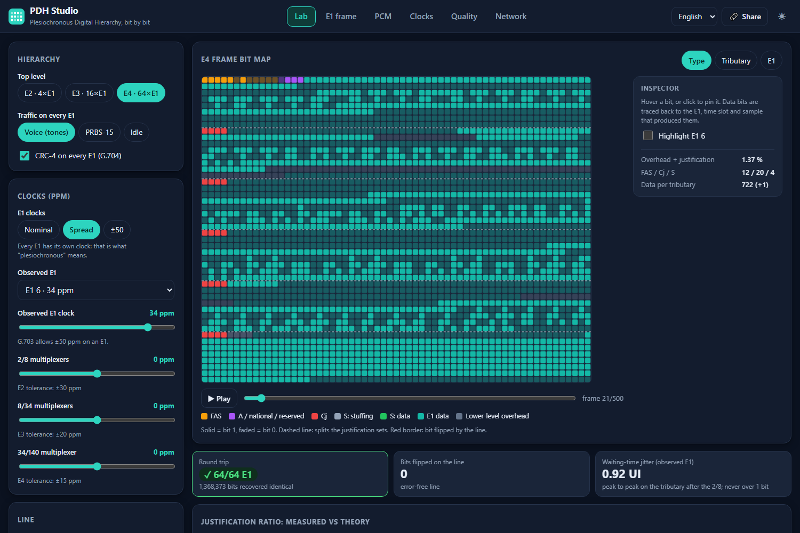
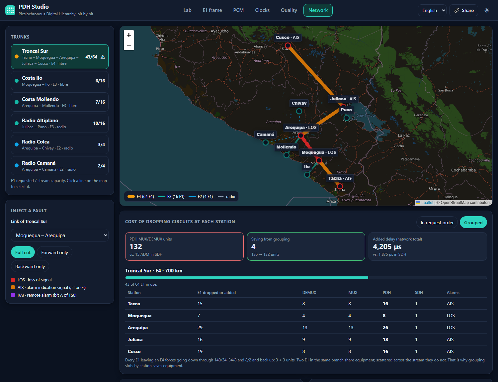

# PDH Studio

A bit-accurate emulator of the **Plesiochronous Digital Hierarchy** (E1 to E4) that runs in the browser.
Every bit of an E1 frame is generated, multiplexed through three levels of justification (stuffing) multiplexers up to an E4, sent over a line that can flip bits, demultiplexed again and compared with what was sent. Nothing is animated by hand: the pictures are drawn from the real bit streams.

It covers the whole chain taught in a transmission course: PCM voice (G.711), the 32-slot E1 frame with CRC-4 and signalling (G.704), the line codes AMI and HDB3 (G.703), the 2/8, 8/34 and 34/140 multiplexers (G.742, G.751), independent clocks and slips, the alarms LOS, LOF, AIS and RAI, and the error performance parameters ES, SES and BBE (G.826).
On top of that it adds three things a block-diagram animation does not give you: a **bit map** where any bit of an E4 can be traced back to the E1, time slot and sample that produced it, a **bridge from a radio hop to E1 quality**, and a **network module** that prices what it costs to drop circuits at a station in PDH against SDH.

> Companion to [radio-link-planner](https://github.com/franco0209/radio-link-planner): the planner tells you whether a radio hop works, this tells you what that hop does to the E1 it carries.

📡 **Try it now: https://franco0209.github.io/pdh-studio/**

<p align="center">
  <br>
  <sub><b>One E4 frame, one square per bit.</b> Overhead (FAS, Cj, S) in colour, payload in teal. Hover a bit and the inspector says which E1, time slot and bit of that E1 it is.</sub>
</p>

## Project status

In active development since **November 2026**: a first working version with six sections and 78 automated tests. The roadmap below shows what is next.

## Sections

| Section | What you can do |
|---|---|
| **Lab** | Pick E2, E3 or E4 (4, 16 or 64 E1). Give every E1 its own clock (±50 ppm), every multiplexer its own clock, and a line bit error ratio. See the bit map of any frame, follow one E1 through the stream, and read the measured justification ratio against theory. Round trip check: how many E1 came back bit for bit. |
| **E1 frame** | The 32 time slots of a frame, TS0 (FAS, NFAS, alarm bit), TS16 (CAS or CCS), the CRC-4 multiframe with its check, the HDB3 / AMI waveform, errors you can inject (a flipped bit, a destroyed FAS) and the resulting alignment, CRC and RAI state. |
| **PCM** | A-law and µ-law compression curves, real SNR measured by encoding a sine, and the bytes of the first samples. |
| **Clocks** | Two free-running ends and an elastic buffer: fill level over time, slips, rate difference, phase drift. The justification ratio of E2, E3 and E4 against the clock error, with real measurements on the curve. |
| **Quality** | From a radio hop (length, frequency, fade margin, terrain) or a raw BER to ES, SES, BBE, UAS and the ratios against the G.826 objectives, simulated second by second and in closed form. |
| **Network** | A map of southern Peru with six trunks (E2, E3, E4; fibre and radio), editable circuit demand, slot assignment, add/drop equipment per station in PDH versus SDH, and fault injection with LOS, AIS and RAI travelling along the trunk. |

The whole scenario lives in the URL hash, so you can bookmark or share any state. English and Spanish, light and dark theme, keyboard operable.

<p align="center">
  <br>
  <sub><b>A cut on the main trunk.</b> LOS is raised at both ends of the dead link and AIS travels onwards; the table prices every station.</sub>
</p>

## What sets it apart

1. **Bit traceability.** The multiplexers move *symbols*, a bit plus a tag that says which bit of which E1 it is. After three levels of multiplexing the tag is still there, so the E4 bit map can say "this is bit 3 of TS5 of E1 frame 118 of E1 22", and the demultiplexed result is compared with the original *including the tags*.
2. **Where is my E1?** In PDH you cannot read an E1 out of an E4 at a fixed position: justification shifts it frame by frame. The tool plots that position, which is the visible reason a node needs 3 demultiplexers and 3 multiplexers to drop a single E1.
3. **Theory against measurement, everywhere.** The stuffing ratio of every level is measured on the running multiplexers and compared with the value computed from the clocks (0.424, 0.436 and 0.419 at nominal clocks). Slips are counted by integrating the buffer and checked against `256 bits / rate difference`. Block errors are simulated and checked against the exact binomial.
4. **A radio hop becomes an E1 quality figure.** The same Vigants-Barnett availability model as radio-link-planner gives the outage, a coherent QPSK curve gives the clear-sky BER, and both go through the G.826 block arithmetic.
5. **The price of PDH, measured.** Dropping circuits is costed unit by unit and compared with an SDH add-drop multiplexer (see below).

## How the multiplexer works

Each level has four tributaries with their own clocks and one line clock. A frame offers every tributary a fixed number of data bits plus **one justification opportunity** (the S bit). Before each frame the multiplexer looks at how many bits the tributary has delivered (from its real clock) and how many it already sent:

```
for every frame, for every tributary:
  level = bits arrived so far - bits already sent
  if level - data_bits_per_frame >= 1:   # the store is ahead by more than one frame
      S carries a data bit;  Cj = 0...0
  else:
      S is stuffing;         Cj = 1...1
```

The control bits Cj are repeated 3 times (E2, E3) or 5 times (E4) and the receiver decides by majority: a single error in Cj is corrected, two errors in a group of three cost one wrong decision, which is exactly what you see in the lab when you raise the BER. Because the decision depends only on the clocks, a faster tributary stuffs less and a slower one more, and the ratio of stuffed frames is the measure of the clock difference.

| Level | Standard | Frame | Sets | Data / tributary | Cj / tributary | Rate | Nominal stuffing ratio |
|---|---|---|---|---|---|---|---|
| 2/8 | G.742 | 848 bits | 4 × 212 | 205 (+1) | 3 | 8 448 kbit/s | 0.424 |
| 8/34 | G.751 | 1 536 bits | 4 × 384 | 377 (+1) | 3 | 34 368 kbit/s | 0.436 |
| 34/140 | G.751 | 2 928 bits | 6 × 488 | 722 (+1) | 5 | 139 264 kbit/s | 0.419 |

The numbers are the ones on the project slides and the test suite asserts all of them.

## The price of PDH: add/drop cost

Taking one E1 out of an E4 means going down through 140/34, 34/8 and 8/2 and back up again: **3 demultiplexers + 3 multiplexers** (the cost model in `core/hierarchy.ts`). Two circuits in the same branch of the multiplexing tree share that equipment; circuits scattered over the 64 positions pay for each branch. SDH reaches the tributary through a pointer with one add-drop multiplexer.

The network module therefore also decides **which E1 slot each circuit gets**:

| Strategy | What it does | Guarantee |
|---|---|---|
| In request order | Fills slots one after another as demands arrive | none |
| Grouped | Tries 4 orderings (as requested, by first station, by last station, longest first) × 3 alignments (none, E2 branch, E3 branch) = 12 candidate plans per trunk and keeps the one needing the fewest units | never worse than the request order; **not** proven optimal, the exact assignment is a combinatorial packing problem |

Cost of the search: 12 candidate plans per trunk, each costed in time proportional to stations × circuits, negligible next to the multiplexing itself. On the bundled southern Peru network the grouped plan saves 4 of 136 units: modest, and reported as measured rather than as a headline.

## Validation

`npm test` runs 78 tests. Some of the ones that matter most:

- **Bit-exact round trip**: 4, 16 and 64 E1, each with a different clock, go up to E2, E3 and E4 and come back identical, tags included.
- **Layouts**: frame lengths, number of FAS, Cj, S and data bits, data per tributary (205 / 377 / 722), frame rates and the overhead of 256, 576 and 1 792 kbit/s.
- **G.711**: known codes for silence and full scale, monotonic, round trip within one quantisation step.
- **G.704**: CRC-4 is a true polynomial remainder (a codeword followed by its CRC leaves remainder 0), the multiframe word is `001011`, one flipped payload bit is caught in exactly one block, alignment is found at any offset, LOF after 3 wrong FAS.
- **HDB3 / B8ZS**: round trip on random data, at most 3 (7) zeros in a row, bounded DC.
- **Clocks**: ±50 ppm gives 204.8 bit/s and one slip every 1.25 s; the integrated buffer slips as often as the formula.
- **G.826**: Monte Carlo against the exact binomial, 10 consecutive SES start unavailability.

## How good is it? Limits

- **The control loop is a threshold on the store fill**, enough to reproduce the justification statistics, not a model of a real phase comparator. Jitter is reported as the peak-to-peak deviation of the cumulative bit stream from a straight line (waiting-time jitter before the smoothing PLL), not as a G.823 filtered measurement.
- **E1, E2, E3 and E4 only.** The North American and Japanese rates are in the hierarchy table and B8ZS is implemented, but T1 framing (D4, ESF, CRC-6) is not yet.
- **The G.826 objectives used are the end-to-end ones for the 1.5 to 5 Mbit/s class**; a real section gets a share of them. The share given to the radio (10 %) is an emulator assumption and is labelled as such in the UI.
- **Radio bridge**: outage by Vigants-Barnett as in radio-link-planner (a planning estimate, not a measurement), every outage second counted as severely errored, clear-sky BER from a coherent QPSK curve calibrated at a 10⁻⁶ threshold. It ignores rain and interference.
- **The network is a sample** (six trunks). Demand is editable, the topology is not yet.
- Details, formulas and sources are in [docs/METHODOLOGY.md](docs/METHODOLOGY.md).

## Run it

```bash
npm install
npm run dev      # http://localhost:5173
npm test         # 78 tests of the emulation core
npm run build    # production build in dist/
```

## Project layout

```
src/
  core/         Pure TypeScript: bits, PCM, E1, line codes, multiplexers, clocks, performance, network
  components/   Bit map (canvas), lab, E1 inspector, charts, network map
  state/        URL (de)serialisation
  i18n/         Spanish / English
```

The core has no dependency on React or the DOM, so it can be reused in a CLI or a test bench (every test runs without a browser).

## Tech

React 19, TypeScript, Vite, Leaflet, Vitest. The charts and the waveform are hand-written SVG and the bit map is a canvas, so there is no charting dependency. Same stack as radio-link-planner.

## Roadmap

- [x] PCM, E1 with CRC-4 / CAS, AMI and HDB3
- [x] 2/8, 8/34 and 34/140 multiplexers with justification, bit-exact round trip
- [x] Slips, alarms, G.826 performance, radio hop bridge
- [x] Network module with add/drop cost and fault propagation
- [ ] T1 framing (D4, ESF, CRC-6) and the North American multiplexers (DS2, DS3)
- [ ] Voice through the chain: microphone to A-law to E1 to E4 and back, with audible slips
- [ ] G.823 jitter tolerance test with a sinusoidal jitter generator
- [ ] Editable topology and exchange of the sample network for your own
- [ ] Export traces to VCD and WaveDrom
- [ ] Portuguese

## Data and attribution

Maps: © OpenStreetMap contributors, requested from the public tile server (please respect its usage policy if you deploy this publicly). Standards: ITU-T G.702, G.703, G.704, G.706, G.711, G.732, G.742, G.751, G.775, G.823, G.826. Textbooks: Bellamy, *Digital Telephony*; Tomasi, *Sistemas de comunicaciones electrónicas*; Valdar, *Understanding Telecommunications Networks*.

## License

MIT
